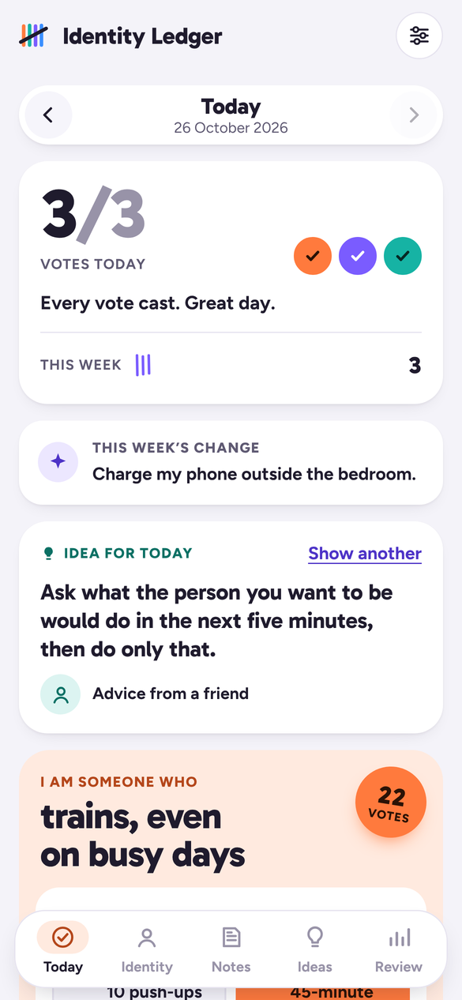
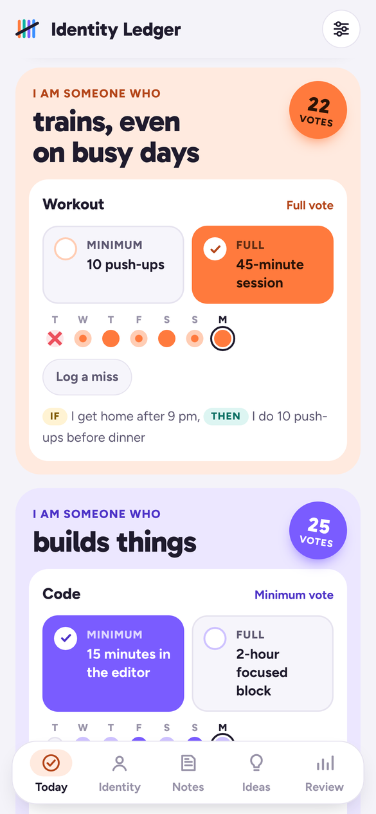
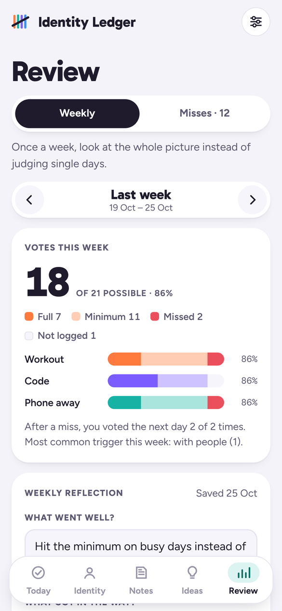
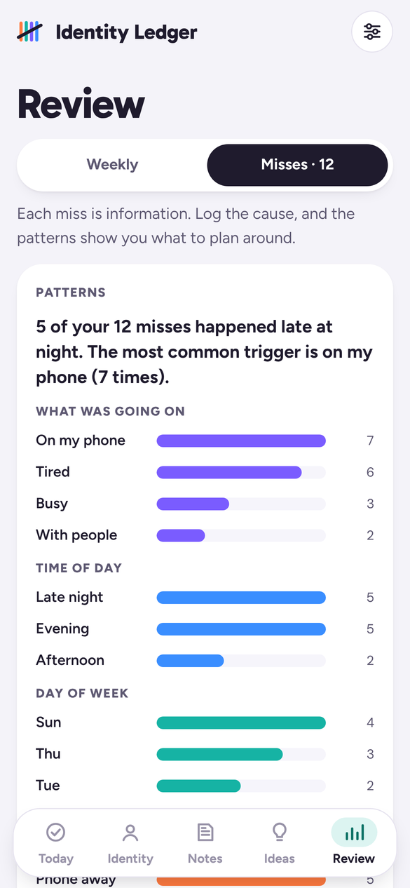

# Identity Ledger

An Android app for building habits around who you want to become. Every day you do the behavior, you cast a vote for that identity.

**[⬇ Download the APK](../../releases/latest)** · **[▶ Try it in your browser](https://khalidoibrahim.github.io/identity-ledger/)** (tap *Explore example data* to see it filled in)

<p>
  
  
  
  
</p>

## Features

- **Today** – vote for each identity with a *minimum* version (small enough for your worst day) or the *full* version, see your 7-day dots, and get a "never miss twice" nudge after a miss
- **Identity** – as many identities as you like ("I am someone who trains, even on busy days"), each with one or two proof behaviors, a 30-day score and total votes
- **Notes** – daily prompts for thinking about who you want to be; pin the ones that matter or turn a note into an identity
- **Ideas** – save lessons from books, podcasts, videos and people, link them to identities, and get one back on Today
- **Review** – weekly numbers, a weekly reflection, and patterns in your misses (time of day, triggers, if-then plans)
- Example data to explore, plus backup and restore

All data stays on your phone. There are no accounts and no network calls.

## Download

Download **IdentityLedger.apk** from the [latest release](../../releases/latest) and open it on an Android phone running Android 7 or newer. Allow "Install unknown apps" when asked. If Play Protect offers to scan the app, tap **Scan app**, then install.

The APK is signed with Android's official `apksigner` and asks for no permissions.

## Built with

HTML, CSS and JavaScript, packaged for Android with [Capacitor](https://capacitorjs.com). Each push to `main` builds, signs, verifies and publishes the APK with GitHub Actions.

```
www/                     the app (also published as the browser version)
docs/screenshots/        README screenshots
icons/                   launcher icons
scripts/                 build helpers (bundles fonts for offline use)
.github/workflows/       APK build, signing and release
```
